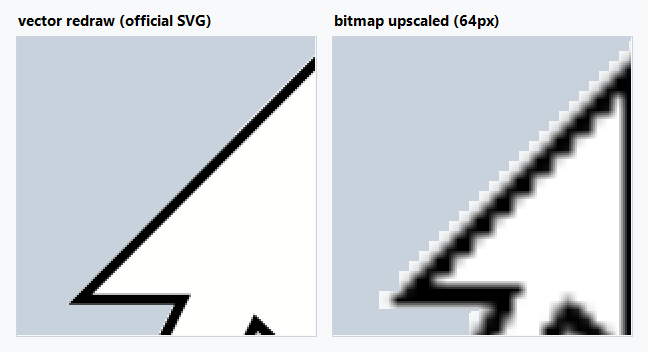

# CursorMirror

在 mstsc 窗口上叠画一个**本地渲染**的鼠标光标，让「本地光标」和 mstsc 自带的「远程光标」同时可见 —— 也就是 ToDesk 那种双鼠标观感。

不改远端、不装驱动、不需要管理员权限。

平时两个光标重合，**网络一卡就分离，分离的距离就是当前延迟** —— 比看延迟数字直观。



## 原理

mstsc 在会话区域内会把系统光标隐藏（`SetCursor(NULL)`），然后用服务端下发的形状自己画一个。所以窗口里只剩下一个"远程"光标。

本程序把**本地那一份**补回来：

1. 每 8ms 取本地指针真实位置
2. 识别当前光标形状，用**微软官方矢量数据**按目标尺寸重绘（见下）
3. 还原成预乘 alpha 的 BGRA，通过分层窗口 `UpdateLayeredWindow(ULW_ALPHA)` 画在指针位置

### 光标是矢量画的

Windows 自带的光标矢量图就在 `C:\Windows\Cursors\*.svg`（`viewBox="0 0 32 32"`，白底黑边）。这些坐标已经抄进 `CursorArt.cs`，运行时不需要读文件、不解析 XML。

```csharp
VectorCursor c = CursorArt.Render(CursorKind.Arrow, 320, null, 100);
// c.Pixels / c.Width / c.Height / c.HotspotX / c.HotspotY
```

**一个函数，一个 size 参数。** 支持：箭头、I 型、十字、上下/左右/四向缩放、向上箭头、禁止。其余形状（手型、等待、画笔等）退回位图路径。

为什么不直接把 64px 位图拉大：放到 320px 时边缘全是锯齿和灰边。上图左为矢量重绘，右为位图放大，都是第 15 档（320px）。

坐标要留意两点：

- 原图是 **Y 轴向上**，载入时统一翻转一次
- `viewBox` 本身就是光标画布，**按 1:1 映射**。不能把图形包围盒拉伸填满方形 —— 真实 128px 箭头只占画布的 39%×59%，拉伸会画大 2.6 倍

热点也取自真实 `.cur`：箭头取尖角，对称形状取中心。

| 光标 | 来源 | 语义 |
|---|---|---|
| mstsc 原生光标 | 客户端 sprite，位置即时回显 | 远程位置 |
| 本程序的镜像光标 | 本地 pixel，跟手 | 本地位置 |

平时重合，**网络一卡就分离，分离距离≈延迟**。

## 用法

双击 `CursorMirror.exe`。托盘出现图标，连上 RDP 把鼠标移进 mstsc 窗口 → 第二个光标出现。

需要 Windows 10/11 x64 和 .NET Framework 4.x（系统自带，不用另装）。免安装，单文件。

**只要指针在 mstsc 窗口范围内就会绘制，不管 mstsc 是不是前台窗口。**
（早期版本要求 mstsc 是前台窗口，导致没点它时光标消失，已修正。）

### 热键

| 热键 | 作用 |
|---|---|
| `Ctrl+Alt+P` | 暂停 / 恢复 |
| `Ctrl+Alt+M` | 范围：仅 mstsc 窗口 / 全屏都画 |
| `Ctrl+Alt++` | 放大一档 |
| `Ctrl+Alt+-` | 缩小一档 |
| `Ctrl+Alt+Q` | 退出 |

托盘菜单是自绘的 Win11 风格面板（圆角、胶囊开关、滑块），深色模式跟随系统。

**标题栏右侧是总开关**：关掉就表示当前不用这个程序 —— 镜像光标立即消失，下面的选项全部变灰不可点，状态写入 `CursorMirror.ini`，下次启动保持。

### 尺寸档位

和 Windows「设置 → 辅助功能 → 鼠标指针和触控」里的大小滑块**同一套 15 档**，语义一一对应：

| 档位 | 1 | 2 | 3 | 4 | 5 | 6 | 7 | 8 | 9 | 10 | 11 | 12 | 13 | 14 | 15 |
|---|---|---|---|---|---|---|---|---|---|---|---|---|---|---|---|
| 96 DPI | 32 | 40 | 48 | 56 | 64 | 72 | 80 | 88 | 96 | 104 | 112 | 120 | 128 | 144 | 160 |
| 你的 200% | 64 | 80 | 96 | 112 | 128 | 144 | 160 | 176 | 192 | 208 | 224 | 240 | 256 | 288 | 320 |

系统里设成第几档，这里就选第几档，两个光标一样大。

- 托盘菜单里是一个**滑块**，拖动即可，实时预览；右侧只显示档位数字（`6`），不写「第 n 档」。
- `Ctrl+Alt++` / `Ctrl+Alt+-` 每次跳一档。
- 默认「跟随系统」：直接匹配 Windows 当前指针大小，不动它就不会错。
- 选择写入 `CursorMirror.ini`，下次双击自动生效。

### 参数

```
CursorMirror.exe [--size auto|1..15] [--alpha 10..100] [--tint RRGGBB]
                 [--flip h|v|both|off] [--proc mstsc,msrdc] [--vector on|off]
                 [--mode mstsc|always] [--log <path>]
```

- `--size 1..15` 取档位序号（同 Windows 滑块），`--size auto` 跟随系统指针大小
- `--vector off` 关掉矢量重绘，退回位图放大（对照用）
- `--tint` 给本地光标染色（例如 `--tint 00A0FF`），方便区分哪一个是本地
- `--alpha` 降低本地光标不透明度，减少遮挡
- `--proc` 要匹配的客户端进程名，默认 `mstsc,msrdc`（后者是 Windows App）
- `--log` 诊断日志；`--selftest <png>` 把当前光标渲染成 PNG；`--probe x,y` 问"这个点会不会画"
- `--shot <png>` 把托盘菜单渲染成图片（`--off` 画停用态），不需要点托盘
- `--makeicon <ico>` 重新生成多尺寸图标文件

## 配置文件

`CursorMirror.ini`（与 exe 同目录，首次修改设置后自动生成）：

```ini
size=96
alpha=100
flip=h
mode=mstsc
proc=mstsc,msrdc
```

`size=auto` 表示跟随真实光标。

## 已知边界

- **全屏独占程序 / 安全桌面（UAC、锁屏、Ctrl+Alt+Del）**：分层窗口不显示，此时只剩一个光标
- **镜像光标不跟随远端光标形状**：mstsc 把系统光标设为 NULL 后取不到形状，程序复用最后一次有效形状，最差回退为标准箭头。本地镜像的意义是"跟手"，不是"像远端"
- **多显示器负坐标**：按物理像素处理，正常
- **DPI**：进程声明 per-monitor-v2，坐标是物理像素
- 只影响视觉，不注入任何输入，不接管鼠标

## 托盘图标

托盘图标不走 `System.Windows.Forms.NotifyIcon`，而是直接调 `Shell_NotifyIcon`——两者混用时图标会被外壳静默丢弃（程序照跑，托盘里就是没有），提权启动反而正常，很难自查。

关键点：

- `NOTIFYICON_VERSION_4` 下左键单击发的是 `NIN_SELECT (0x0400)`，不是 `WM_LBUTTONUP`。若两个都响应，菜单会被打开又立刻关掉，表现为"点了没反应"
- 启动后调 `Shell_NotifyIconGetRect` 自检：返回 `hr == 0` 才算真的落在任务栏上，失败会写进日志
- 监听 `TaskbarCreated` 消息，Explorer 重启后自动重新添加

## 构建

```powershell
$csc = 'C:\Windows\Microsoft.NET\Framework64\v4.0.30319\csc.exe'
& $csc /nologo /target:winexe /platform:x64 /optimize+ `
  /out:CursorMirror.exe /win32icon:CursorMirror.ico `
  /r:System.dll /r:System.Core.dll /r:System.Drawing.dll /r:System.Windows.Forms.dll `
  CursorMirror.cs ModernMenu.cs CursorArt.cs IconFactory.cs
```

.NET Framework 4.x 自带，无需 SDK、无需联网。

`CursorMirror.ico` 由 `IconFactory` 生成，九种尺寸（16/20/24/32/40/48/64/128/256）各画一遍再打包 —— 单个 32px 图标缩到 20px 或放到 48px 都会糊。托盘图标和 exe 图标是同一份。改图标后重新生成：

```powershell
CursorMirror.exe --makeicon CursorMirror.ico
```

注意 `.ico` 里的帧写成 **32bpp DIB**（BITMAPINFOHEADER + BGRA + AND mask），不要用 PNG 压缩帧 —— `System.Drawing.Icon` 读 PNG 帧会得到彩色噪点。

## 许可

[MIT](LICENSE)。

光标造型取自 Windows 自带的矢量图（`C:\Windows\Cursors\*.svg`），其版权归 Microsoft 所有；本仓库只使用了这些形状的坐标数据，用于在本机复现同一个指针。

